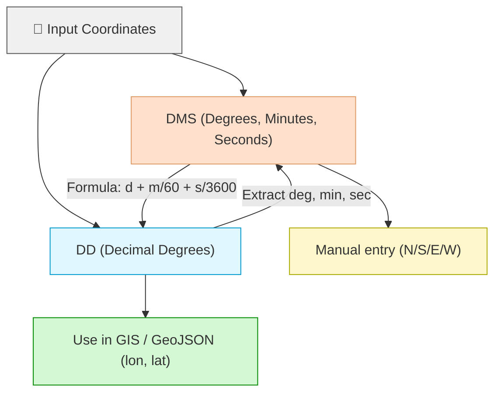

# კოორდინატების კონვერტაცია - Coordinate conversion

კოორდინატები ხშირად გვხვდება ორ ფორმატში:

- **DMS** - Degrees, Minutes, Seconds (გრადუსები, წუთები, წამები)
- **DD** - Decimal Degrees (მეათედი გრადუსები)

ამ გვერდზე ნახავ ორივე მიმართულებით კონვერტაციის ფუნქციებს, ტექსტიდან კოორდინატის ამოკითხვას, სიის დამუშავებას და QGIS-ში გამოყენებას.

!!! note "კოორდინატების თანმიმდევრობა"
    ყოველთვის გაითვალისწინე თანმიმდევრობა. ადამიანი ამბობს "განედი, გრძედი" (lat, lon), ხოლო QGIS-ში `QgsPointXY(x, y)` ნიშნავს **`QgsPointXY(გრძედი, განედი)`**.

---

## 1) DMS → DD

**ფორმულა:**

\[
\text{DD} = d + \frac{m}{60} + \frac{s}{3600}
\]

სამხრეთ და დასავლეთ ნახევარსფეროში DD უარყოფითია (N/E = +, S/W = −).

**მაგალითი:** Kotia Cave, Chiatura-Perevisa-Sveri-Tvalueti-Gezruli, Georgia. <br>
კოორდინატები [Google Earth-იდან](https://www.google.com/maps/place/42%C2%B012'47.8%22N+43%C2%B019'27.7%22E/@42.2058273,43.2713168,21099m/data=!3m1!1e3!4m4!3m3!8m2!3d42.213286!4d43.324367?entry=ttu&g_ep=EgoyMDI0MTIxMS4wIKXMDSoASAFQAw%3D%3D) <br>
`42°12'47.83"N 43°19'27.72"E` > `42.213286° 43.324367°`

```py title="dms_to_dd.py" linenums="1"
def dms_to_dd(deg, minutes, seconds, ref=None):
    """DMS -> DD. ref: 'N', 'S', 'E' ან 'W' (არასავალდებულო)"""
    dd = abs(deg) + minutes / 60 + seconds / 3600
    if ref in ('S', 'W') or deg < 0:
        dd = -dd
    return dd

print(dms_to_dd(42, 12, 47.83, 'N'))
print(dms_to_dd(43, 19, 27.72, 'E'))

# შედეგი: 42.21328611111112
#         43.32436666666667
```

---

## 2) DD → DMS

```py title="dd_to_dms.py" linenums="1"
def dd_to_dms(dd, precision=2):
    """DD -> (გრადუსი, წუთი, წამი). ნიშანი გრადუსს ეძლევა."""
    sign = -1 if dd < 0 else 1

    # ჯერ ყველაფერს წამებში გადავიყვანთ და ვამრგვალებთ,
    # რომ წამებში 60.0 არ მივიღოთ
    total = round(abs(dd) * 3600, precision)
    minutes_total, seconds = divmod(total, 60)
    degrees, minutes = divmod(int(minutes_total), 60)

    return sign * degrees, minutes, round(seconds, precision)

print(dd_to_dms(41.688554))
print(dd_to_dms(44.693789))
print(dd_to_dms(-12.5))

# შედეგი: (41, 41, 18.79)
#         (44, 41, 37.64)
#         (-12, 30, 0.0)
```

!!! warning "წამების დამრგვალება"
    თუ ჯერ გრადუსებს, მერე წუთებს და ბოლოს წამებს ცალ-ცალკე დავთვლით, დამრგვალებისას შეიძლება მივიღოთ `59.99999` ან `60.0` წამი. ამიტომ ზემოთ ფუნქცია ჯერ ყველაფერს წამებში გადაიყვანს და მხოლოდ მერე ყოფს.

---

## 3) DMS ტექსტიდან DD

Google Maps-დან ან დოკუმენტიდან კოორდინატი ხშირად ტექსტად გვაქვს, მაგალითად `42°12'47.83"N`. რეგულარული გამოსახულებით შეგვიძლია პირდაპირ გადავიყვანოთ DD-ში.

```py title="parse_dms.py" linenums="1"
import re

DMS_PATTERN = re.compile(
    r"""(?P<deg>\d+)\s*[°ºd]\s*
        (?P<min>\d+)\s*['′m]\s*
        (?P<sec>\d+(?:[.,]\d+)?)\s*(?:["″s]|'')?\s*
        (?P<ref>[NSEW])?""",
    re.IGNORECASE | re.VERBOSE
)

def parse_dms(text):
    """'42°12'47.83"N' -> 42.213286..."""
    m = DMS_PATTERN.search(text)
    if not m:
        raise ValueError(f'ფორმატი ვერ ამოვიცანი: {text}')

    ref = m.group('ref').upper() if m.group('ref') else None
    return dms_to_dd(int(m.group('deg')),
                     int(m.group('min')),
                     float(m.group('sec').replace(',', '.')),
                     ref)

print(parse_dms('''42°12'47.83"N'''))
print(parse_dms('''43°19'27.72"E'''))
print(parse_dms('''12°30'0"W'''))

# შედეგი: 42.21328611111112
#         43.32436666666667
#         -12.5
```

`parse_dms()` იყენებს პირველ განყოფილებაში აღწერილ `dms_to_dd()` ფუნქციას, ამიტომ ორივე ერთ სესიაში გაუშვი.

---

## 4) სიის კონვერტაცია და CSV-ში შენახვა

ერთი წერტილის ნაცვლად ხშირად მთელი სია გვაქვს. ქვემოთ ყოველი წერტილი ინახება სახელით, განედით და გრძედით. შედეგი ისე იწერება, რომ QGIS-მა პირდაპირ გახსნას.

```py title="batch_convert_to_csv.py" linenums="1"
import csv

# (სახელი, განედი(d, m, s), გრძედი(d, m, s))
points_dms = [
    ('Kotia Cave', (42, 12, 47.83), (43, 19, 27.72)),
    ('Tbilisi',    (41, 41, 55.00), (44, 47, 59.00)),
    ('Batumi',     (41, 38, 55.00), (41, 38, 24.00)),
]

rows = []
for name, lat, lon in points_dms:
    rows.append({
        'Name': name,
        'lat': round(dms_to_dd(*lat, 'N'), 6),
        'lon': round(dms_to_dd(*lon, 'E'), 6),
    })

with open('converted_coordinates.csv', 'w', newline='', encoding='utf-8') as f:
    writer = csv.DictWriter(f, fieldnames=['Name', 'lat', 'lon'])
    writer.writeheader()
    writer.writerows(rows)

print(f'შენახულია {len(rows)} წერტილი: converted_coordinates.csv')
```

შედეგი `converted_coordinates.csv`:

```text
Name,lat,lon
Kotia Cave,42.213286,43.324367
Tbilisi,41.698611,44.799722
Batumi,41.648611,41.64
```

---

## 5) QGIS-ში გამოყენება

### CSV-ის გახსნა წერტილებად

```py title="csv_to_layer.py" linenums="1"
uri = ('file:///C:/Users/Public/Documents/GIS/converted_coordinates.csv'
       '?delimiter=,&xField=lon&yField=lat&crs=EPSG:4326')

layer = QgsVectorLayer(uri, 'converted_points', 'delimitedtext')
QgsProject.instance().addMapLayer(layer)
```

თუ შრე ფაილად გვინდა (Shapefile ან GeoPackage), იხილე [შრის შექმნა CSV-დან](PyQGIS_Create_layer.md).

### გადაყვანა სხვა საკოორდინატო სისტემაში

გეოგრაფიული კოორდინატები (`EPSG:4326`) საქართველოში ხშირად უნდა გადავიყვანოთ პროექციულ სისტემაში, მაგალითად `EPSG:32638` (UTM 38N).

```py title="transform_point.py" linenums="1"
src = QgsCoordinateReferenceSystem('EPSG:4326')
dst = QgsCoordinateReferenceSystem('EPSG:32638')

transform = QgsCoordinateTransform(src, dst, QgsProject.instance())

lon, lat = 43.324367, 42.213286
point = transform.transform(QgsPointXY(lon, lat))   # x = გრძედი, y = განედი

print(round(point.x(), 2), round(point.y(), 2))
```

### Field Calculator-ში

QGIS-ს DD → DMS გარდასაქმნელად ჩაშენებული ფუნქცია აქვს:

```sql
-- განედი DMS ფორმატში
to_dms(y($geometry), 'y', 2)

-- გრძედი DMS ფორმატში
to_dms(x($geometry), 'x', 2)

-- მეათედი გრადუსები
x($geometry)   -- longitude
y($geometry)   -- latitude
```

!!! info "შენიშვნა"
    ფუნქცია `to_dms()` მუშაობს გეოგრაფიულ კოორდინატებზე. თუ შრე პროექციულ სისტემაშია, ჯერ გადაიყვანე `transform($geometry, 'EPSG:32638', 'EPSG:4326')`-ით.

---

## 🗺️ დიაგრამა



---

## ✅ დავალება

1. მოძებნე შენი სკოლის კოორდინატები Google Maps-ზე (DMS ფორმატში).
2. გადაიყვანე **DD ფორმატში** `parse_dms()` ფუნქციით.
3. ჩაწერე CSV-ში `Name, lat, lon` სვეტებით.
4. ჩატვირთე QGIS-ში `Add Delimited Text Layer`-ით ან `csv_to_layer.py` სკრიპტით და შეამოწმე რუკაზე.
5. **დამატებით:** გადაიყვანე წერტილი `EPSG:32638`-ში და შეადარე მიღებული X, Y მნიშვნელობები QGIS-ის `Identify` ხელსაწყოს შედეგს.
